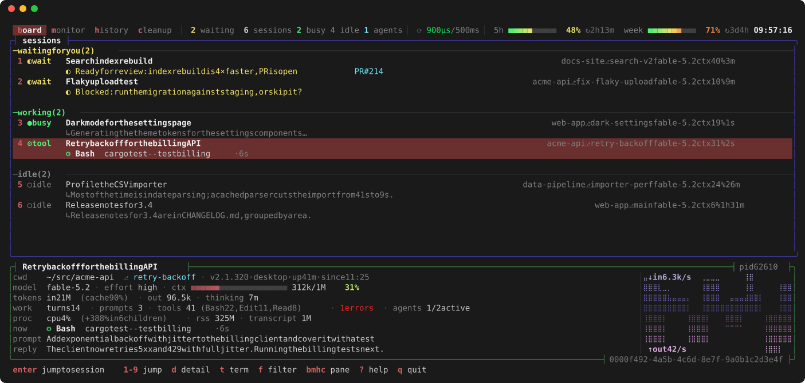
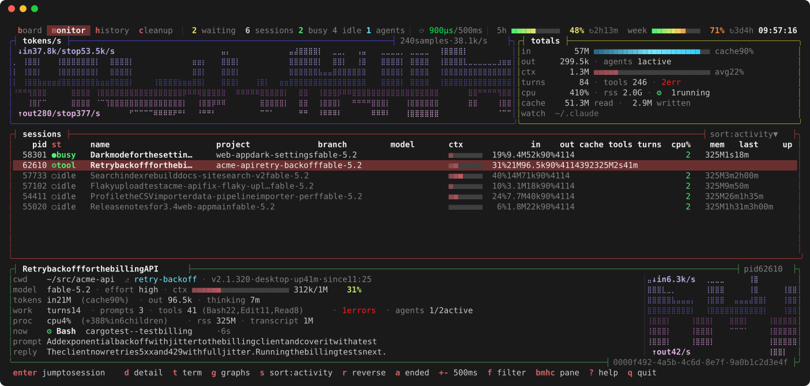
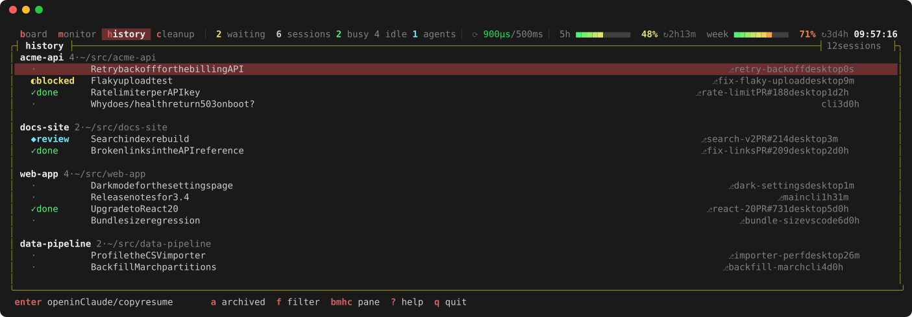
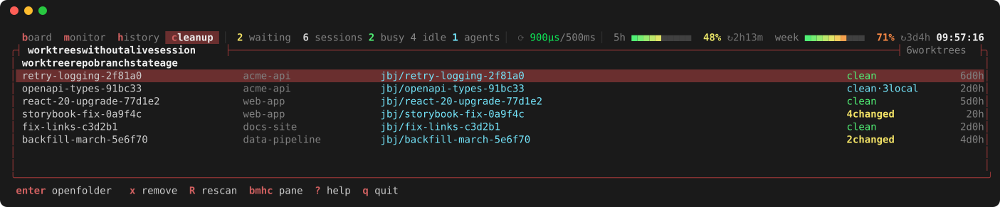

<p align="center">
  
</p>

<h1 align="center">weft</h1>

<p align="center">A live terminal board for every Claude Code session on your machine.</p>

<h4 align="center">
  <a href="#-getting-started">Install</a>
  ·
  <a href="#-panes">Panes</a>
  ·
  <a href="#%EF%B8%8F-keys">Keys</a>
  ·
  <a href="#-usage-limits">Usage limits</a>
  ·
  <a href="#-how-it-works">How it works</a>
</h4>


weft shows what waits for you, what works and what is idle across all your Claude Code sessions,
desktop and terminal alike, and jumps to any of them with one key. It reads only what Claude Code
already writes to disk: no daemon, no hooks, nothing to configure.

## ✨ Features

- 🧭 **Board** of live sessions, sorted into *waiting for you*, *working* and *idle*
- 🚀 **Jump** to a session: the desktop app, the tmux pane, the iTerm2 session or the Terminal tab
- 📈 **Monitor** in the style of btop: token graphs, totals, context meters, CPU and memory per session
- 🗂️ **History** of past sessions by project, with status, branch and PR from the desktop app
- 🧹 **Cleanup** of agent worktrees that no session uses any more
- ⏱️ Your 5-hour and weekly **usage limits** in the header
- ⚡ One native Rust binary; a tick costs under 2 ms, even with transcripts of hundreds of megabytes

## ⚡️ Requirements

- A **Rust** toolchain to build (`brew install rust` or [rustup](https://rustup.rs))
- [Claude Code](https://claude.com/claude-code), CLI or desktop app
- **macOS** for jump and for the desktop app's metadata
- `jq` for the [statusline tap](#-usage-limits) **_(optional)_**

## 🚀 Getting Started

```bash
cargo install --path .     # installs to ~/.cargo/bin/weft
weft
```

Or run it without installing: `cargo build --release && ./target/release/weft`.

<details><summary>Options</summary>

```
weft [OPTIONS]

  -i, --interval <MS>     refresh interval in ms            [default: 500, env WEFT_INTERVAL_MS]
  -c, --context <TOKENS>  override context window (e.g. 1m) [default: per model, env WEFT_CONTEXT]
  -d, --dir <PATH>        Claude config dir                 [default: $CLAUDE_CONFIG_DIR or ~/.claude]
  -m, --metadata <PATH>   Claude desktop session metadata   [default: ~/Library/Application Support/Claude/claude-code-sessions]
      --dump              collect once, print a plain table and exit
      --no-usage          do not poll subscription usage limits    [env WEFT_USAGE=0]
```

</details>

## 🪟 Panes

`b`, `m`, `h` and `c` go straight to a pane; `tab` and `shift-tab` step through them.

### Board



Live sessions as numbered cards. A session waits for you when the desktop app's turn summary says
it is blocked or ready for review. Each card shows what the session does now, what it needs, or its
last reply. `enter` or `1`–`9` jumps to the session; `d` toggles the detail box.

### Monitor



- **tokens/s**: input tokens per second (cache reads included) grow up, output tokens grow down.
  Auto-scaled and smoothed over 4 s.
- **totals**: tokens, cache ratio, context pressure, turns, tool calls, errors, running tools,
  active subagents, CPU and memory across all sessions.
- **sessions**: every live Claude Code process with status (`● busy`, `⚙ tool`, `○ idle`,
  `✕ ended`), project (worktrees as `repo:worktree`), branch, model, context meter, tokens, cache
  hit, tools, turns, CPU (with its tool subprocesses), memory, last activity and uptime. Columns
  drop out on narrow terminals. A session that exits stays, greyed out, for 60 s.
- **detail**: the selected session's model and effort, token breakdown, thinking time, tool
  histogram, subagents, what it does right now, the last prompt and reply, and its own graph.

### History



Past sessions grouped by project, with worktrees folded into their repo. Status, branch, PR and
source come from the desktop app's metadata where it exists. `enter` opens a desktop session in
Claude, or copies `cd … && claude --resume <id>` for a terminal session. `a` shows archived
sessions.

### Cleanup



Agent worktrees (`<repo>/.claude/worktrees/*`) that no running session and no unarchived desktop
session uses, with their branch, changed files and commits that no remote has. `x` runs
`git worktree remove` after you confirm. Git refuses a worktree with changes, and the branch stays.

## ⌨️ Keys

Press `?` in weft for the keys of the current pane. The essentials:

| Key | Action | Key | Action |
|---|---|---|---|
| `b` `m` `h` `c` | go to a pane | `tab` / `shift-tab` | next / previous pane |
| `↑` `↓` / `j` `k` | move selection | `pgup` `pgdn` `home` `end` | move faster |
| `enter` | jump / open | `1`–`9` | jump to a card (board) |
| `f` / `/` | filter (`esc` clears) | `d` | detail box |
| `t` | terminate (SIGTERM, asks first) | `a` | ended (monitor) / archived (history) |
| `s` `S` / `←` `→` | sort column (monitor) | `r` | reverse sort (monitor) |
| `g` | token graphs (monitor) | `+` / `-` | refresh interval ± 100 ms |
| `x` | remove worktree (cleanup) | `R` | rescan worktrees (cleanup) |
| `?` | help | `q` / `esc` / `ctrl-c` | quit |

<details><summary>How jump works (macOS, best effort)</summary>

- **Desktop sessions** open through `claude://code/continue?session=local_…`.
- **Terminal sessions** select the tmux pane, iTerm2 session or Terminal tab on the process's tty,
  then activate the app that hosts the process. iTerm2 and Terminal ask once for Automation
  permission.
- **Editors** open the project. Anything else opens the folder.

</details>

## ⏱️ Usage limits

The header shows how close your subscription is to its 5-hour and weekly limits, with the time
until each resets. It greys out when the numbers are more than 12 minutes old, and shows `!`
with a reason when polling fails.

Claude Code hands every statusline command a `rate_limits` object with the same numbers `/usage`
shows. Mirroring it to a file costs nothing, so weft prefers that. Add this near the top of your
statusline script, right after it reads stdin into `$input`:

```bash
{
  cc_dir=${CLAUDE_CONFIG_DIR:-$HOME/.claude}
  cc_tmp="$cc_dir/weft-usage.json.$$"
  printf '%s' "$input" | jq -c 'select(.rate_limits != null) | {at: now, rate_limits}' > "$cc_tmp" 2>/dev/null
  if [[ -s $cc_tmp ]]; then mv -f "$cc_tmp" "$cc_dir/weft-usage.json"; else rm -f "$cc_tmp"; fi
} 2>/dev/null
```

Without the tap, or when it is older than 10 minutes, weft calls the endpoint that `/usage` calls.
It uses the OAuth token that Claude Code keeps in the macOS keychain (`Claude Code-credentials`) or
in `~/.claude/.credentials.json`, and passes it to `curl` on stdin, never on the command line. It
polls every 5 minutes at most and backs off for as long as a 429 asks. `--no-usage` turns both off.

<details><summary>Troubleshooting</summary>

- `weft --dump` prints which source the numbers came from and how old they are.
- `WEFT_USAGE_DEBUG=/path/file` saves the last raw endpoint response (headers and body, no token).

</details>

## 🔍 How it works

Everything except the usage limits comes from files that Claude Code already writes:

| Source | Gives |
|---|---|
| `~/.claude/sessions/<pid>.json` | the live registry: pid, session id, cwd, name, status, version, entrypoint |
| `~/.claude/projects/<cwd>/<session>.jsonl` | the transcript: tokens, model, effort, tool calls, prompts, replies, branch |
| `~/.claude/projects/<cwd>/<session>/subagents/*.jsonl` | subagent tokens, and whether they still run |
| the process table | CPU and memory of each session and its children; `claude` processes not in the registry |
| `~/Library/Application Support/Claude/claude-code-sessions` | the desktop app's status, attention, branch and PRs (`--metadata`; read only) |

- Live sessions join the desktop metadata on the registry's `hostSessionId`, past sessions on
  `cliSessionId`.
- Transcripts are tailed: each tick reads only the new bytes, and a SIMD substring search skips
  lines before any JSON is parsed.
- Split assistant entries that share a message id count once per API response.
- The collector runs on its own thread and hands the UI an immutable snapshot, so the UI never
  waits on I/O.
- Context percentages use a 1M window for current models and 200k for the 4.5 family and older.
  `--context` overrides it.

## 🛠️ Development

```bash
cargo test
cargo run --release
```

## License

MIT
